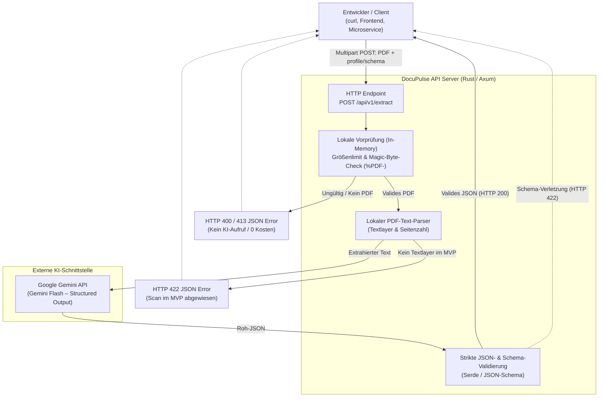

# 🦀 DocuPulse – Document Processing API
> **Leichtgewichtige, typsichere REST-API für Software-Entwickler: PDF-Dokumente einlesen, semantisch analysieren und als strikt validiertes JSON ausgeben.**

[](https://www.rust-lang.org/)
[](https://github.com/tokio-rs/axum)
[](https://serde.rs/)
[](https://ai.google.dev/)

---

## 1. Problemstellung & Projektidee

### Problemstellung
In fast jedem modernen Softwareprojekt müssen unstrukturierte oder semi-strukturierte PDF-Dokumente (z. B. Rechnungen, Belege, Zertifikate, Formulare) in strukturierte JSON-Daten für Datenbanken, Microservices oder Web-Frontends überführt werden.  
Entwickler stehen dabei vor drei typischen Problemen:
1. **Klassische OCR-/Parser-Pipelines** sind starr, brechen bei kleinsten Layout-Änderungen und erfordern oft schwerfällige Deployments (> 1 GB Docker-Images mit komplexen Systemabhängigkeiten).
2. **Große Enterprise-Cloud-Dienste** (wie AWS Textract oder Google Document AI) sind teuer, komplex in der Integration und liefern meist unübersichtliche Geometrie-Bäume statt direkt nutzbarer Fachdaten.
3. **Direkte LLM-Aufrufe** liefern häufig unzuverlässige Text- oder Markdown-Antworten (` ```json ... ``` `) ohne harte Schema-Garantie, was in nachgelagerten Services zu Laufzeitfehlern führt.

### Projektidee
**DocuPulse** löst dieses Problem durch eine schlanke, entwicklerzentrierte **Document Processing REST-API**.  
Entwickler senden ein PDF-Dokument zusammen mit einem vordefinierten Profil (`profile=invoice`) oder einem eigenen JSON-Schema (`schema={...}`) an einen einzigen HTTP-Endpunkt (`POST /api/v1/extract`). DocuPulse prüft und parst das PDF lokal im Arbeitsspeicher, nutzt ein Sprachmodell (Google Gemini Flash) zur semantischen Strukturierung und garantiert durch strikte Server-Validierung, dass ausschließlich **100 % wohlgeformtes, schema-konformes JSON** zurückgegeben wird.

---

## 2. Zielgruppe

DocuPulse richtet sich gezielt an **Software-Entwickler und API-Integratoren**:

- **Backend- & Microservice-Entwickler:** Benötigen eine verlässliche, typsichere Schnittstelle, um PDF-Dokumente ohne eigenen Parsing-Code in strukturierte JSON-Objekte für ihre Geschäftslogik umzuwandeln.
- **Fullstack- & Frontend-Entwickler:** Wollen Nutzern im Browser das Hochladen eines PDFs ermöglichen, um Formulare (z. B. Rechnungsdaten) innerhalb weniger Sekunden automatisch vorauszufüllen.
- **DevOps- & Platform-Engineers:** Bevorzugen leichtgewichtige, zustandslose Services ohne Datenbank-Zwang, mit minimalem RAM-Verbrauch (< 50 MB) und einfacher Konfiguration per Umgebungsvariable.

---

## 3. Projektziel & Mehrwert

Das Ziel des Projekts ist die Entwicklung einer **realistischen, im Semester vollständig umsetzbaren und testbaren API**, die folgenden Mehrwert bietet:

- **Fokussierter MVP-Durchstich („PDF rein → JSON raus“):** Ein klarer, synchroner REST-Endpunkt für textbasierte PDFs mit sofort nutzbarem Rechnungs-Profil (`invoice`) sowie dynamischer JSON-Schema-Unterstützung.
- **Strikte Schema- & Typgarantie:** Jede erfolgreiche API-Antwort (`HTTP 200`) ist garantiert valides JSON und entspricht dem angeforderten Schema – ohne Markdown-Reste oder Halluzinationen bei Datentypen.
- **Kostenschutz durch lokale Vorprüfung:** Korrupte Dateien, falsche Dateiformate oder leere Dokumente werden lokal abgefangen, **bevor** ein kostenpflichtiger oder zeitintensiver externer KI-Aufruf stattfindet.
- **Datenschutz (Zero Data Retention):** Alle Dokumente werden ausschließlich flüchtig im Arbeitsspeicher (In-Memory) verarbeitet und niemals auf der Festplatte persistiert.
- **Ressourcenschonende Umsetzung in Rust:** Durch die Implementierung mit `axum`, `tokio` und `serde` erreicht der Service minimale Latenz im Pre-Processing und einen äußerst geringen Speicherbedarf.

---

## 4. Systemüberblick & Architektur



---

## 5. Quickstart & Entwickler-Vorschau (Zielbild)

### 1. Synchroner PDF-Upload mit Standardprofil (`invoice`)
```bash
curl -X POST "http://localhost:8000/api/v1/extract" \
  -F "file=@rechnung.pdf" \
  -F "profile=invoice"
```

**Erwartete JSON-Antwort (`HTTP 200 OK`):**
```json
{
  "status": "success",
  "document": {
    "filename": "rechnung.pdf",
    "pages": 1
  },
  "data": {
    "invoice_number": "RE-2026-9812",
    "date": "2026-10-14",
    "vendor": "Acme Cloud Services GmbH",
    "currency": "EUR",
    "total_amount": 1190.00,
    "tax_amount": 190.00,
    "line_items": [
      {
        "description": "Server Hosting Q4",
        "quantity": 1,
        "unit_price": 1000.00,
        "total": 1000.00
      }
    ]
  },
  "processing_time_ms": 1840
}
```

### 2. Generische Extraktion mit benutzerdefiniertem JSON-Schema (`schema`)
```bash
curl -X POST "http://localhost:8000/api/v1/extract" \
  -F "file=@zertifikat.pdf" \
  -F 'schema={
        "type": "object",
        "properties": {
          "recipient": {"type": "string"},
          "course_name": {"type": "string"},
          "grade": {"type": "number"}
        },
        "required": ["recipient", "course_name"]
      }'
```

---

## 6. Projektstruktur & Deliverables (Phase 1)

Alle Dokumente der Phase 1 (Produktspezifikation & Anforderungsanalyse) sind im Repository verlinkt:

```text
PAISE-Projekt/
│
├── README.md               # Projektüberblick: Idee, Problem, Zielgruppe & Projektziel
│
├── docs/
│   ├── requirements.md     # Detaillierte Anforderungen (10 User Stories, FA, NFA, MoSCoW, Konfliktprüfung)
│   ├── mvp.md              # MVP-Scope: In-/Out-of-Scope, End-to-End-Flow, API-Kosten & Abhängigkeiten
│   └── ai-usage.md         # Dokumentation des KI-Einsatzes, Prompts, Ergebnisse & kritische Reflexion
│
└── [Ab Phase 2: Cargo.toml, src/, tests/]
```

- 📄 **[docs/requirements.md](docs/requirements.md):** Vollständige Anforderungsspezifikation, Personas, 10 User Stories mit überprüfbaren Given-When-Then-Akzeptanzkriterien, funktionale/nichtfunktionale Anforderungen und Widerspruchsprüfung.
- 🎯 **[docs/mvp.md](docs/mvp.md):** Klare Abgrenzung des MVP-Scopes (In-Scope vs. Out-of-Scope), Kosten- und Abhängigkeitsanalyse für die externe Gemini API sowie Definition of Done.
- 🤖 **[docs/ai-usage.md](docs/ai-usage.md):** Nachvollziehbare Dokumentation unseres KI-Einsatzes im Requirements-Engineering-Prozess inklusive kritischer Bewertung und manueller Korrekturen.
