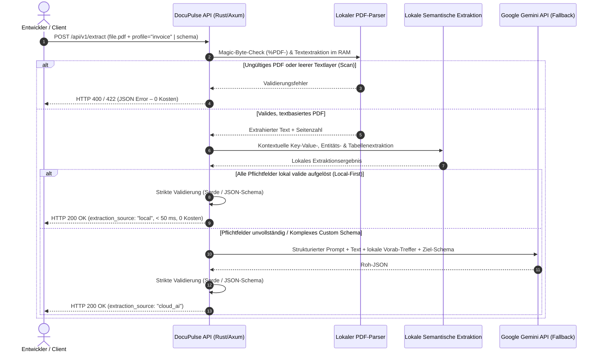

# 🎯 MVP-Scope & Abgrenzung: DocuPulse

**Projekt:** DocuPulse – Leichtgewichtige Document Processing API (PDF-zu-JSON)  
**Phase:** 1 – Produktspezifikation & Anforderungsanalyse  
**Zielgruppe:** Software-Entwickler & API-Integratoren  
**Stand:** November 2026  

---

## 1. Zielsetzung des MVPs

Das Minimum Viable Product (MVP) von **DocuPulse** verfolgt ein klares, innerhalb eines Semesters realistisch umsetzbares Ziel:

> **Einen vollständigen, Ende-zu-Ende demonstrierbaren API-Durchstich bereitzustellen, der textbasierte PDF-Dokumente über einen HTTP-Endpunkt entgegennimmt, über eine zweistufige Hybrid-Pipeline (lokale semantische Informationsextraktion im Arbeitsspeicher + externer KI-Fallback) analysiert und als strikt validiertes, typsicheres JSON zurückgibt.**

Statt ein überladenes Gesamtsystem mit eigenem Web-Frontend, Benutzerverwaltung und Datenbank-Persistenz zu entwerfen – oder sich ausschließlich als reiner Proxy auf eine externe KI zu verlassen –, konzentriert sich das MVP zu 100 % auf die **Developer Experience (DX)**, **eigene lokale semantische Extraktionslogik** und **Zuverlässigkeit der Kern-Pipeline („PDF rein → JSON raus“)**.

---

## 2. Demonstrierbarer Kern-Anwendungsfall (End-to-End MVP Flow)

Das MVP deckt folgenden vollständigen Anwendungsfall ab:

1. **API-Request:** Ein Entwickler (oder ein aufrufender Microservice) sendet ein textbasiertes PDF-Dokument per `POST /api/v1/extract` (`multipart/form-data`) an den DocuPulse-Server. Dabei gibt er entweder das Standardprofil `profile=invoice` oder ein eigenes JSON-Schema (`schema={...}`) an.
2. **Lokale Vorprüfung & Textextraktion (Pre-Processing):**
   - Der Server prüft Dateigröße (≤ 10 MB) und PDF-Header (`%PDF-`).
   - Der Textlayer sowie die Seitenzahl werden lokal im Arbeitsspeicher aus dem PDF extrahiert.
   - Ist die Datei korrupt oder enthält sie keinen extrahierbaren Textlayer (reiner Bild-Scan), bricht der Server **sofort lokal** kontrolliert mit HTTP `400 Bad Request` bzw. `422 Unprocessable Entity` ab.
3. **Stufe 1 – Lokale semantische Informationsextraktion (Local-First Engine):**
   - Eine in Rust implementierte semantische Extraktions-Engine analysiert den extrahierten Text kontext- und heuristikbasiert (Erkennung von Schlüssel-Wert-Nachbarschaften, Synonym-Labels, Normalisierung von ISO-Datumsangaben, Währungen und Beträgen sowie Tabellenerkennung für Rechnungspositionen).
   - Werden alle Pflichtfelder des Ziel-Schemas (`profile=invoice` oder `schema`) bereits lokal vollständig und typsicher erkannt, wird der externe KI-Aufruf **übersprungen** (`extraction_source: "local"`, Antwortzeit < 50 ms, 0 € API-Kosten).
4. **Stufe 2 – Externer KI-Fallback (Google Gemini Flash):**
   - Nur wenn die lokale semantische Extraktion bei unkonventionellen Dokument-Layouts oder komplexen Custom-Schemas nicht alle Pflichtfelder auflösen kann, wird der extrahierte Text zusammen mit den lokal bereits erkannten Teil-Entitäten und den Schema-Vorgaben asynchron an die **Google Gemini API (Gemini Flash)** gesendet (`extraction_source: "cloud_ai"`).
5. **Strikte Schema- & Typ-Validierung:** Das Ergebnis (aus lokaler Extraktion oder KI-Fallback) wird gegen die Zielstruktur (vordefiniertes `Invoice`-Struct bzw. übergebenes JSON-Schema) validiert. Ungültige Antworten oder Markdown-Artefakte werden abgefangen.
6. **JSON-Response & Speicherbereinigung:** Der Client erhält synchron eine HTTP-`200`-Antwort mit dem validierten JSON-Dokument und Laufzeit-Metadaten (`extraction_source`, `processing_time_ms`, `pages`). Alle PDF-Daten im RAM werden unmittelbar nach Request-Ende verworfen (Zero Data Retention).

---

## 3. Im MVP enthalten (In-Scope / Must-Have)

Folgende Funktionen bilden den verbindlichen Umfang für das MVP:

| Bereich | Enthaltene Funktionalität (MVP In-Scope) | Referenz |
| :--- | :--- | :--- |
| **HTTP-Endpunkt** | Synchroner REST-Endpunkt `POST /api/v1/extract` (`multipart/form-data`) sowie ein Health-Check `GET /health`. | `US-01`, `FA-01` |
| **Eingabeformat** | Textbasierte PDF-Dateien (`application/pdf`) bis max. 10 MB und max. 5 Seiten pro synchronem Request. | `US-02`, `FA-02`, `FA-03` |
| **Lokale semantische Extraktion** | In-Memory-Engine für kontextuelle Schlüssel-Wert-Erkennung, Datums-/Betrags-/Währungsnormalisierung und Positions-Tabellen (`extraction_source: "local"`). | `US-03`, `FA-04`, `NFA-01` |
| **Hybrid-Router & KI-Fallback** | Automatische Vollständigkeitsprüfung des lokalen Ergebnisses; nahtloser Fallback auf Google Gemini Flash bei komplexen/unvollständigen Dokumenten (`extraction_source: "cloud_ai"`). | `US-03`, `FA-05` |
| **Standard-Profil (`invoice`)** | Sofort nutzbares Extraktionsprofil für Rechnungen (`invoice_number`, `date`, `vendor`, `currency`, `total_amount`, `tax_amount`, `line_items`). | `US-04`, `FA-06` |
| **Custom JSON-Schema** | Übergabe eines benutzerdefinierten JSON-Schemas im Request zur flexiblen Datenextraktion für beliebige Dokumenttypen. | `US-05`, `FA-07` |
| **Ausgabe & Validierung** | 100 % valides, typsicheres JSON (`application/json`) durch serverseitige Deserialisierung und Schema-Prüfung vor dem Senden. | `US-06`, `FA-08`, `NFA-03` |
| **Fehlerbehandlung** | Einheitliche JSON-Fehlermeldungen mit klaren HTTP-Statuscodes (`400`, `413`, `422`, `502`, `504`) ohne Absturz des Servers. | `US-07`, `FA-09` |
| **Datenschutz** | Reine In-Memory-Verarbeitung ohne Speicherung von Dokumenten auf der Festplatte oder in einer Datenbank. | `FA-10`, `NFA-04` |

---

## 4. Nicht im MVP enthalten (Out-of-Scope & Spätere Erweiterungen)

Um den Projektrahmen im Semester zuverlässig einzuhalten, werden folgende Features **bewusst aus dem MVP ausgeschlossen** und in spätere Ausbaustufen (Post-MVP) bzw. komplett außerhalb des Projekts verlagert:

### 4.1 Geplante Erweiterungen nach dem MVP (Should-Have / Could-Have)
- **Multimodaler Scan-/OCR-Fallback (`Should-Have`, US-08):** Verarbeitung gescannter PDFs ohne Textlayer über Vision-Payloads oder lokale OCR. *Begründung:* Im MVP werden reine Bild-Scans nach der Textlayer-Prüfung mit einer klaren Fehlermeldung (`EMPTY_TEXT_LAYER`) abgewiesen, um Komplexität und Token-Kosten gering zu halten.
- **Interaktive OpenAPI-/Swagger-UI (`Should-Have`, US-09):** Automatisch generierte Browser-Dokumentation unter `/swagger-ui`.
- **Asynchrone Job-Queue (`Should-Have`, US-10):** `POST /api/v1/jobs` und Status-Polling für große Dokumente (> 5 Seiten).
- **Quellen-Grounding & Webhooks (`Could-Have`, US-11):** Seitenreferenzen pro extrahiertem Feld und Push-Webhooks.

### 4.2 Explizit ausgeschlossen (Won't-Have)
- **Kein grafisches Web-Frontend (GUI):** DocuPulse ist eine reine Backend-API für Entwickler (Nutzung via `curl`, Postman oder Client-Code).
- **Keine Datenbank-Persistenz:** Keine Speicherung von Dokumenten, Extraktionsergebnissen oder Nutzerkonten in SQL/NoSQL-Datenbanken.
- **Keine Benutzer- und Rechteverwaltung:** Kein OAuth/JWT-Login-System, kein Billing-Portal.
- **Keine anderen Dateiformate:** Keine Unterstützung für Word (`.docx`), Excel (`.xlsx`), E-Mails (`.eml`) oder lose Bilddateien (`.jpg`, `.png`).
- **Kein Training oder Einbetten schwerer lokaler Deep-Learning-Gewichte:** Die lokale semantische Extraktion arbeitet bewusst mit deterministischen/heuristischen Kontext-Parsern in Rust (< 50 MB RAM), statt mehrere Gigabyte große lokale LLM-Gewichte in das Container-Image einzubetten.

---

## 5. Externe APIs, Abhängigkeiten & Kostenbetrachtung

Gemäß den Rahmenbedingungen kombiniert DocuPulse eine eigene **lokale semantische Extraktion** mit einem **externen KI-Service als Fallback**. Abhängigkeiten und Kosten sind wie folgt kalkuliert und abgesichert:

### 5.1 Externe API: Google Gemini API (`gemini-2.5-flash`) als Hybrid-Fallback
- **Zweck:** Semantische Analyse und Schema-Vervollständigung für Dokumente oder komplexe Custom-Schemas, die durch die lokale semantische Extraktion (Stufe 1) nicht bereits zu 100 % aufgelöst werden konnten.
- **Kostenmodell im Semesterprojekt:**
  - Standardisierte Dokumente (z. B. strukturierte Rechnungen) werden bereits durch die **lokale semantische Extraktion zu 100 % lokal (0,00 € / 0 Tokens)** gelöst.
  - Für den Fallback-Pfad wird in Entwicklung, Tests und Demonstration der **kostenlose Google AI Studio Free-Tier** genutzt (**0,00 € Kosten**).
  - Selbst im Paid-Tier lägen die Kosten bei `gemini-2.5-flash` im Bereich von Bruchteilen eines Cents pro Fallback-Aufruf (ca. 1.000–2.000 Input-Tokens).
- **Kostenschutz-Mechanismen in unserer Architektur:**
  1. **Local-First Short-Circuit (`US-03`, `FA-04`, `FA-05`):** Wenn die lokale semantische Extraktions-Engine alle Pflichtfelder des angeforderten Schemas erkennt und validiert, findet **überhaupt kein externer KI-Aufruf** statt.
  2. **Lokaler Pre-Check vor jeder Analyse (`US-02`, `US-07`):** Korrupte Dateien, falsche Dateiformate, leere PDFs oder unzulässige JSON-Schemas werden lokal in Rust abgefangen, **bevor** ein einziger Token verbraucht wird.
  3. **Striktes Größen- und Seitenlimit:** Synchron akzeptierte PDFs sind im MVP auf max. 10 MB bzw. 5 Seiten begrenzt (`FA-01`).
  4. **Text-Extraktion statt Bild-Upload im MVP:** Da im MVP beim Fallback nur der extrahierte Textlayer (wenige Kilobyte) statt hochauflösender Seitenbilder an die KI-API gesendet wird, sinkt der Token-Verbrauch um ca. 80–90 %.

### 5.2 Umgang mit technischen Abhängigkeiten & Risiken
- **Offline-Fähigkeit der lokalen Engine:** Ist kein `GEMINI_API_KEY` konfiguriert oder die externe API nicht erreichbar, funktioniert die lokale semantische Extraktion (`extraction_source: "local"`) für unterstützte Standarddokumente weiterhin vollständig autark.
- **API-Key-Verwaltung:** Der API-Schlüssel (`GEMINI_API_KEY`) für den KI-Fallback wird ausschließlich über Umgebungsvariablen geladen und niemals im Quellcode oder Git-Repository gespeichert.
- **Timeouts & Fehlertoleranz:** Externe HTTP-Aufrufe an die Gemini API erhalten ein festes Timeout (15 Sekunden). Antwortet die externe API bei einem benötigten Fallback nicht rechtzeitig oder mit einem Rate-Limit (`HTTP 429`), gibt DocuPulse kontrolliert `HTTP 502 Bad Gateway` bzw. `HTTP 504 Gateway Timeout` im standardisierten JSON-Fehlerformat zurück.
- **Testbarkeit ohne API-Kosten:** Sowohl die lokale semantische Extraktions-Engine als auch der über einen Rust-Trait abstrahierte KI-Fallback-Client lassen sich in automatisierten Unit- und Integrationstests vollständig offline und deterministisch testen.

---

## 6. Definition of Done (MVP)

Das MVP gilt in der Implementierungsphase als erfolgreich abgeschlossen, wenn:
1. Der Server lokal oder als Container startet und unter `GET /health` mit `HTTP 200` antwortet.
2. Ein Entwickler eine strukturierte Beispiel-Rechnung (`rechnung.pdf`) per `curl` mit `profile=invoice` an `POST /api/v1/extract` senden kann und allein durch die **lokale semantische Extraktion** (`"extraction_source": "local"`, < 50 ms) ein vollständig typisiertes JSON-Ergebnis erhält.
3. Ein Entwickler ein komplexeres PDF oder ein benutzerdefiniertes `schema` senden kann und über das Zusammenspiel aus lokaler Extraktion und **KI-Fallback** (`"extraction_source": "cloud_ai"`) ein gegen dieses Schema validiertes JSON zurückerhält.
4. Ungültige Dateien (z. B. umbenannte `.txt`-Datei, beschädigtes PDF oder Scan ohne Textlayer) sofort lokal mit einem klaren JSON-Fehler (`HTTP 400`/`422`) abgewiesen werden.
5. Automatisierte Tests (`cargo test`) sowohl die lokale semantische Extraktions-Engine als auch den Hybrid-Fallback-Pfad und die Fehlerfälle reproduzierbar prüfen.
